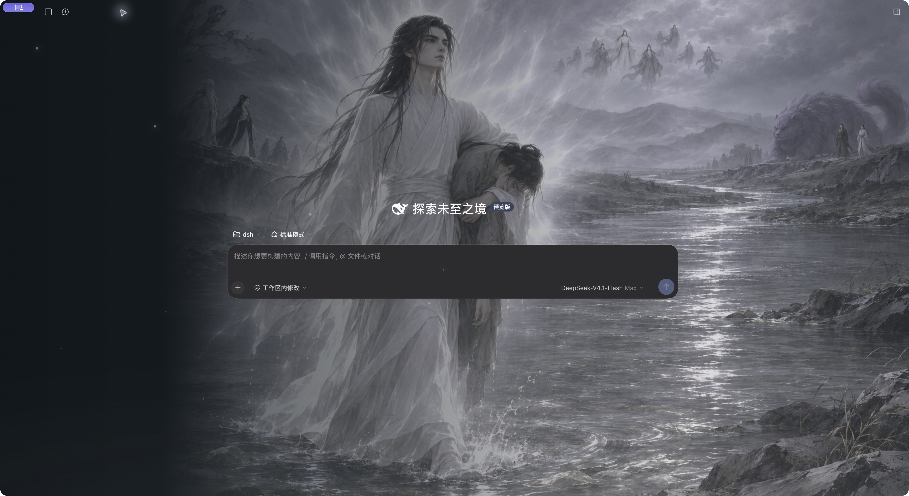
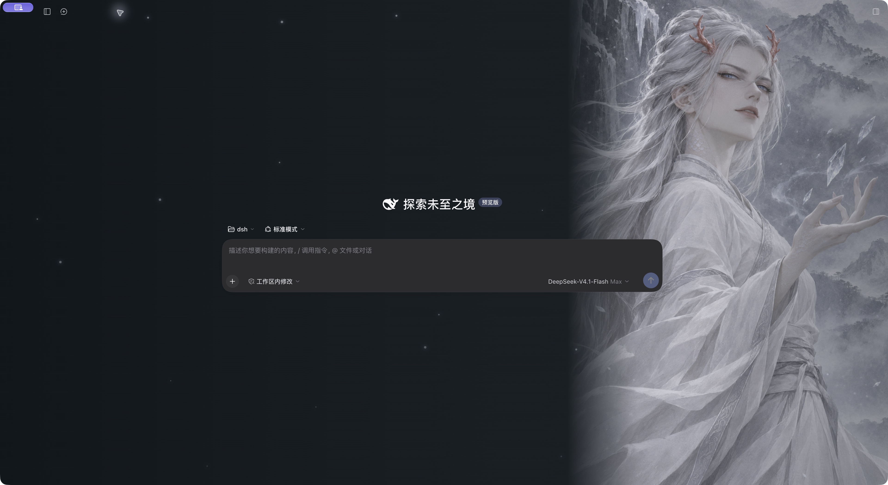

# 蛊真人 · 四时入画

`guzhenren` 是 DSH Web 界面的同人动态皮肤，包含逆流河方源、龙人白凝冰、升仙后黑楼兰和青衣方源四个场景。静态插画搭配雾气、飘雪、微光和淡入淡出，不是人物视频动画。

## 真实界面

以下为 macOS **DeepSeek Harness Desktop 0.2.2-rc.1** 空白欢迎页实机截图，侧边栏已收起。




## 安装与使用

在 DSH 的「插件 → 添加插件」中输入本仓库地址：

```text
https://github.com/fanchw/guzhenren
```

安装后停用其他会覆盖背景和主题的皮肤，再启用 `guzhenren`。从市场安装时使用市场提供的完整固定 commit 安装目标。构建产物已提交，无需在安装时运行构建脚本。

展开侧边栏，点击头像上方的小「蛊」图标打开设置。入口使用宿主已有侧栏操作位，不遮挡账号、不增加整窗底栏。

- 四景手动切换、环境动效开关、阅读模式。
- 自动换景每 30 秒执行；阅读模式、后台页面或系统减少动态效果开启时暂停。
- 默认开启阅读模式、关闭自动换景。关闭阅读模式可让插画更鲜明。
- 卸载或停用后清理样式、事件监听、计时器和图片 Blob URL。
- 浏览器只保存 `guzhenren:appearance:v1` 外观偏好；皮肤不读取聊天、凭据或文件，不请求外部图片服务。

已在上述 Desktop 版本实际验证安装、启用、四景切换、动效开关和账号入口。其他版本及独立 Web 部署尚未实机验收，不声明最低兼容版本。市场的自动兼容性标记可能为 unverified。

## 本地开发

需要 Node.js 22 或更新版本。

```sh
npm ci --ignore-scripts
npm run check
npm run dev
```

打开 http://127.0.0.1:4173 。此开发预览是模拟界面，不连接模型、不读取聊天、不安装到 DSH profile。生产皮肤仅注入背景、主题 token 与场景控件，保留 DSH 的原生界面。

DSH 客户端通过 `window.__ModuleLoader__.load` 注册包名；React 由宿主提供。`shell.overlay` 绘制无交互装饰，`sidebar.footer.action` 提供紧凑入口；`ctx.theme.overrideTokens` 只覆盖背景和侧栏颜色。

参考：[主题接口](https://github.com/deepseek-ai/deepseek-harness/blob/master/packages/client/ui-theme/src/client/index.ts)、[侧栏槽](https://github.com/deepseek-ai/deepseek-harness/blob/master/packages/client/ui-sidebar/src/client/contract/slots.ts)、[客户端包格式](https://github.com/deepseek-ai/deepseek-harness/blob/master/docs/cookbook/adding-a-settings-card.md)。

## 许可与声明

代码与文档采用 [MIT](LICENSE)。AI 生成的同人插画及含插画的截图**不包含在 MIT 授权内**，参见 [ASSETS.md](ASSETS.md)。原作角色等权利归各自权利人所有，本项目不宣称获得原作者授权。场景标题和短句为创作演绎，不作为原著引文。

这是社区皮肤；收录不等于安全认证，也不代表 DSH 官方或市场背书。
